<div align="center">

```
██████╗ ██╗  ██╗ █████╗ ███╗   ██╗██╗   ██╗███████╗██╗  ██╗
██╔══██╗██║  ██║██╔══██╗████╗  ██║██║   ██║██╔════╝██║  ██║
██║  ██║███████║███████║██╔██╗ ██║██║   ██║███████╗███████║
██║  ██║██╔══██║██╔══██║██║╚██╗██║██║   ██║╚════██║██╔══██║
██████╔╝██║  ██║██║  ██║██║ ╚████║╚██████╔╝███████║██║  ██║
╚═════╝ ╚═╝  ╚═╝╚═╝  ╚═╝╚═╝  ╚═══╝ ╚═════╝ ╚══════╝╚═╝  ╚═╝
```

### AI Engineer · Full-Stack Developer · System Design

*Building intelligent systems that scale, from multi-agent pipelines to distributed microservices*

[](https://www.linkedin.com/in/dhanushkumar-amk/)
[](https://dhanushkumar.in/)
[](https://codolio.com/profile/Dhanushkumaramk)
[](mailto:dhanushkumaramk@gmail.com)

</div>

---

<div align="center">
  <h3><code>dhanush@github ~ $ ./contributions.sh</code></h3>
  
</div>

<br>

<div align="center">
  <h3><code>dhanush@github ~ $ whoami</code></h3>
  <table>
    <tr>
      <td valign="top"></td>
      <td valign="top"></td>
    </tr>
  </table>
</div>

---

## `$ cat about.py`

```python
dhanush = {
    "role"      : ["AI Engineer", "Full-Stack Developer", "Backend Architect"],
    "location"  : "Tamil Nadu, India",
    "focus"     : ["Multi-Agent Systems", "LLM Security", "Distributed Backends"],
    "currently" : ["Building production-grade AI systems", "Open Source LLM tooling"],
    "open_to"   : ["AI Engineer", "Full-Stack", "Backend", "LLM Engineer roles"],
}
```

---

## `$ cat skills.json`

| | |
|---|---|
| **AI / GenAI** |         |
| **Frontend** |      |
| **Backend** |       |
| **Databases** |     |
| **DevOps / Cloud** |     |
| **Core** |    |

---

## `$ cat achievements.log`

```
✅ 1000+ problems solved across LeetCode & GeeksforGeeks
🏆 Rank #1 GeeksforGeeks College Coding Score
⭐ Open Source Contributor: Appwrite, n8n, Hoppscotch
📝 Technical blogs published on Medium
🚀 30+ full-stack projects shipped across AI, Web and Infrastructure
```

---

## `$ cat education.txt`

| Degree | Institution | Year | Score |
|--------|------------|------|-------|
| M.Sc. Information Technology | Hindusthan College of Arts and Science | 2025–Present | Pursuing |
| BCA | Nallamuthu Gounder Mahalingam College | 2022–2025 | CGPA 7.92 |

---

## `$ cat certifications.txt`


---

## `$ git log --graph`

<div align="center">


</div>

---

<div align="center">

*"Ship fast. Think deep. Build things that last."*

**Open to AI Engineer · Full Stack · LLM Engineer roles**

[](https://www.linkedin.com/in/dhanushkumar-amk/)

</div>